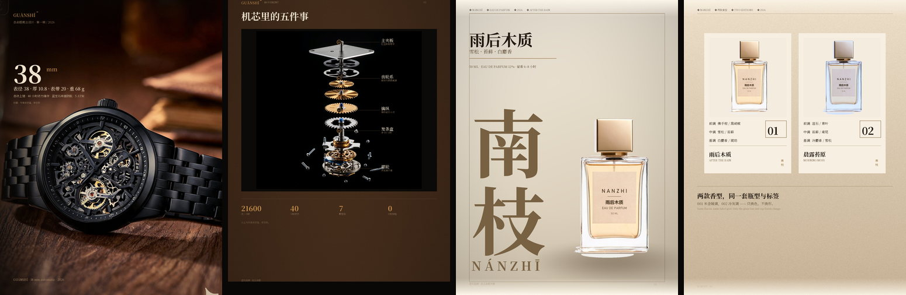
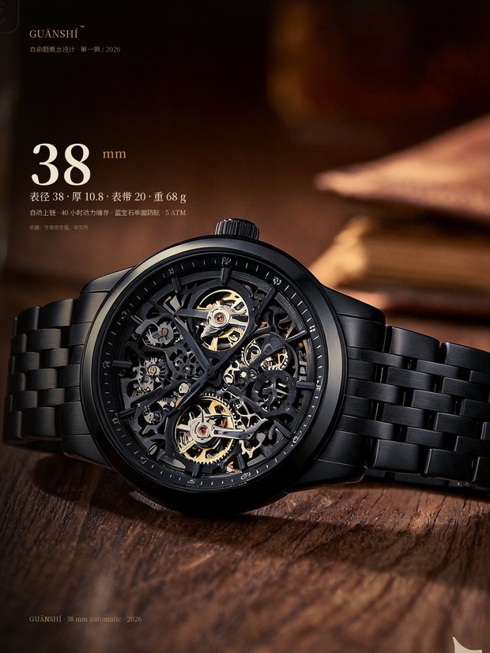
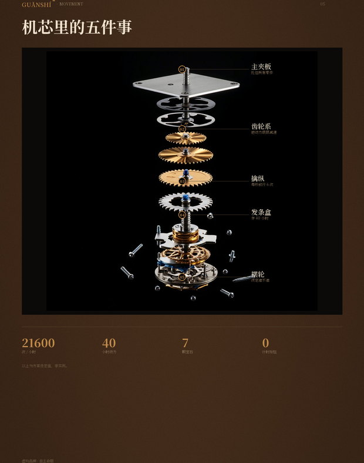
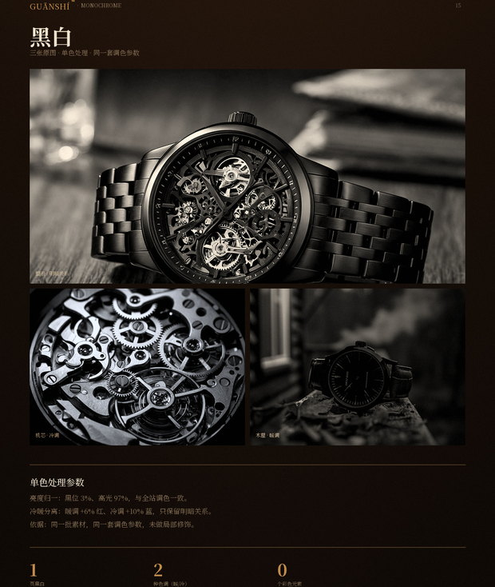
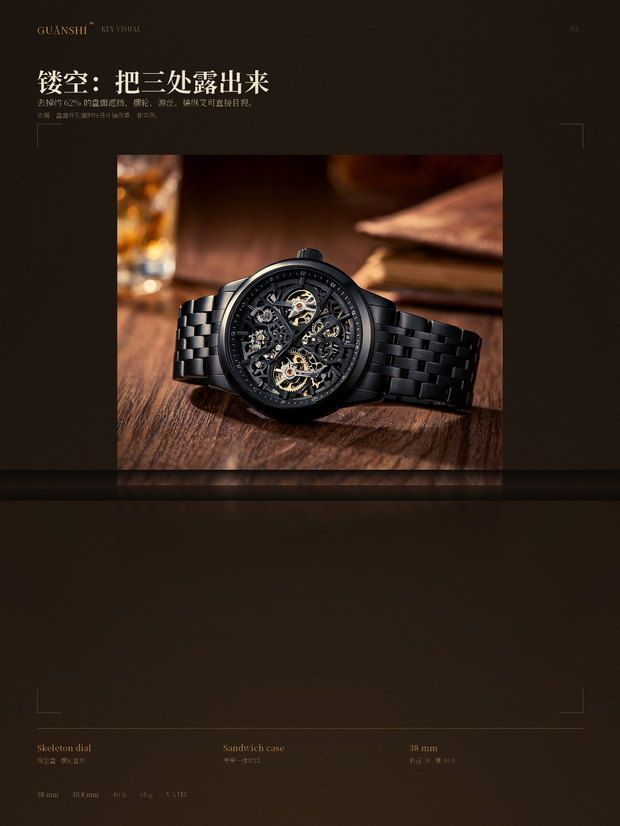
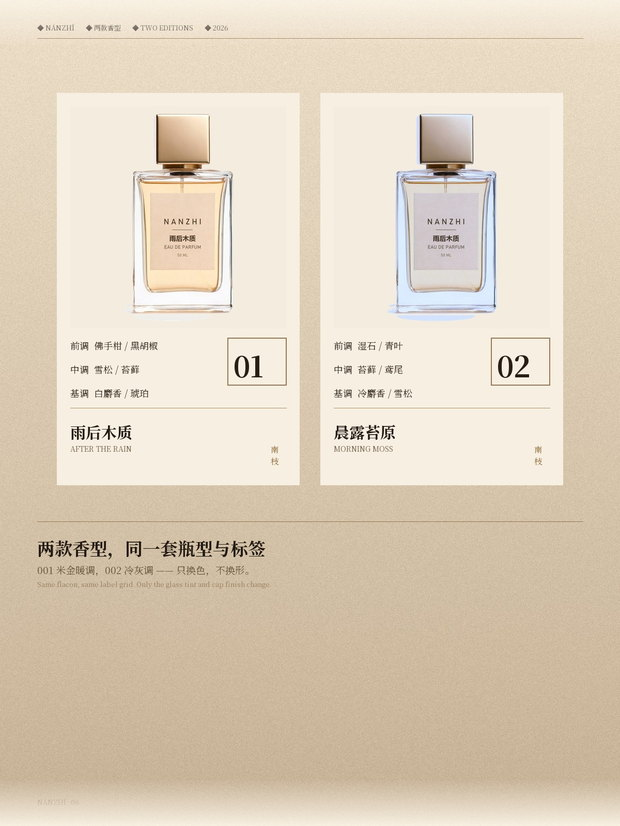
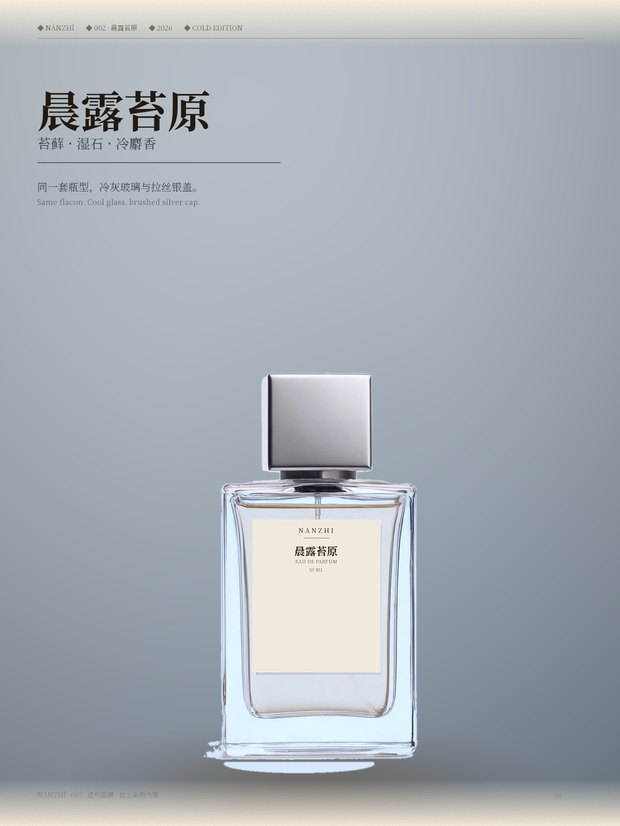
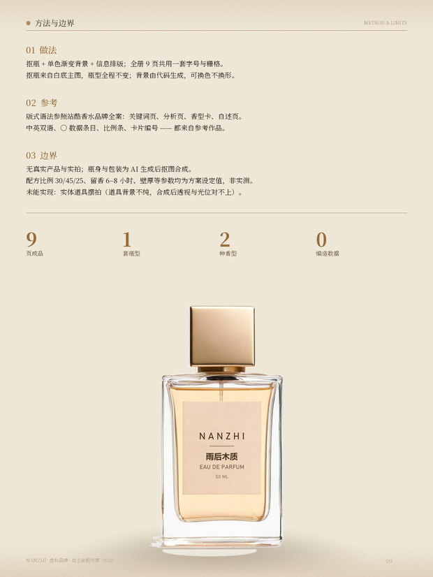

# concept-visual-system

自命题品牌视觉系统的生产流程与验收工具。输入一组产品素材，输出一套 8–20 页的成套页面，并合成为单张连续背景长图。



| 适用 | 不适用 |
|---|---|
| 作品集、概念提案、品牌手册 | 单张或 1–3 张图（直接进行版式设计） |
| 需要多页一致（同一套色、同一光向） | 产品需多角度一致（属 3D 建模范畴） |
| 需要一张可长滚的长图 | 平台主图（纯白背景/尺寸/文字有硬性规范） |
| 从旧电商页面改造为品牌手册 | 以真实拍摄素材为主的项目（重点是版式设计，非调色） |

---

## 组成

| 目录 | 内容 |
|---|---|
| `SKILL.md` | 流程规范：六阶段与门禁、五种页面类型、四档字号、色彩统一参数、两个判定口径 |
| `reference/` | 参考库：输入契约、版式规格、文案句式、已知问题 18 条、两个案例、风格锚点 |
| `scripts/` | 工具脚本 8 个（见下） |
| `templates/` | 禁用词表、白名单、图像位矩阵、页面骨架、已知问题模板 |
| `examples/watch` | 案例一：暗调腕表，17 页，长图 1200×25438（15 个页面脚本） |
| `examples/nanzhi` | 案例二：亮调香水，11 页，长图 1200×17800（5 个页面脚本） |

`scripts/` 明细：

| 脚本 | 作用 |
|---|---|
| `preflight.py` | 开工前校验：Python / Pillow / numpy / 中文字体 / 输出目录 / 磁盘 |
| `bootstrap_fonts.py` | 字体解析与下载：固定来源、大小校验、可选 SHA-256 钉版本 |
| `grade.py` | 色彩统一：黑位、高光、冷暖分离、主光向、暗角、锐化 |
| `compose_long.py` | 连续背景长图合成与切回单页（通用版） |
| `checkcopy.py` | 文案禁用词扫描（五类），命中退出码 1 |
| `gen_images.py` | 素材生成（MiniMax image-01），无密钥时 `--no-gen` 仅输出提示词清单 |
| `selftest.py` | 冒烟测试 15 项 |
| `reproduce.py` | 复现验收：重跑后与 `reference/` 逐页比对，输出 PASS / FAIL |

---

## 验收定义

满足依赖的任意机器上，以下命令退出码为 0 即视为通过：

```bash
git clone https://github.com/070703John-chen/concept-visual-system.git
cd concept-visual-system
pip install -r requirements.txt

python scripts/preflight.py --out-dir .
python scripts/bootstrap_fonts.py
python scripts/reproduce.py --case watch     # 17 页 + 长图 1200×25438
python scripts/reproduce.py --case nanzhi    # 11 页 + 长图 1200×17800
```

判定规则：页数与每页高度必须一致（差 1 px 判 FAIL）；每页平均像素差 ≤ 6/255（仅容许 JPEG 重编码差异）。

当前实测结果与逐页数据见 [`docs/HANDOFF-1.3.0.md`](docs/HANDOFF-1.3.0.md)。

---

## 环境

| 项 | 要求 |
|---|---|
| Python | 3.11.9（3.9+ 可运行，验收基准以 3.11.9 为准） |
| 依赖 | `Pillow==9.5.0`、`numpy==1.26.4`（见 `requirements.txt`） |
| 字体 | 思源宋体（Noto Serif CJK SC）。解析顺序：`CVS_FONT` → `assets/fonts/` → 系统路径 → 报错退出 |
| 密钥 | 仅 `gen_images.py` 需要 `MINIMAX_API_KEY`；版式设计与验收链路不依赖密钥 |

字体与密钥的获取方式见 `assets/fonts/README.md`、`.env.example`。

---

## 方法与口径

流程分六阶段，每阶段有明确通过条件，见 `SKILL.md` 第三节。其中阶段 ⑥（统一收口：
调色 → 透明化 → 连续背景 → 长图 → 切回单页）是成套页面与"多张单图"的分界。

两类主张的判定口径不同：

- 文案与数字：以可核对事实为准，禁用词由 `checkcopy.py` 机器拦截。
- 版式与配色：以交付方选定为准，不以数据推翻。

素材生成的模型限制（正面表盘会生成错误文字、同一产品多角度无法一致等）见 `SKILL.md` 第十二节。

---

## 案例

**观时 GUĀNSHÍ** — 暗调腕表，17 页

| 封面 | 机芯分解 |
|---|---|
|  |  |

| 单色页 | 主视觉 |
|---|---|
|  |  |

**南枝 NÁNZHÍ** — 亮调香水，11 页，由旧电商页面改造

| 封面 | 双香型 |
|---|---|
|  |  |

| 冷调款 | 封底 |
|---|---|
|  |  |

---

## 许可

MIT，见 `LICENSE`。

案例品牌（观时 GUĀNSHÍ、南枝 NÁNZHÍ）为虚构，用于演示流程，不对应任何真实商品。
文中参数均为方案设定值，非实测。